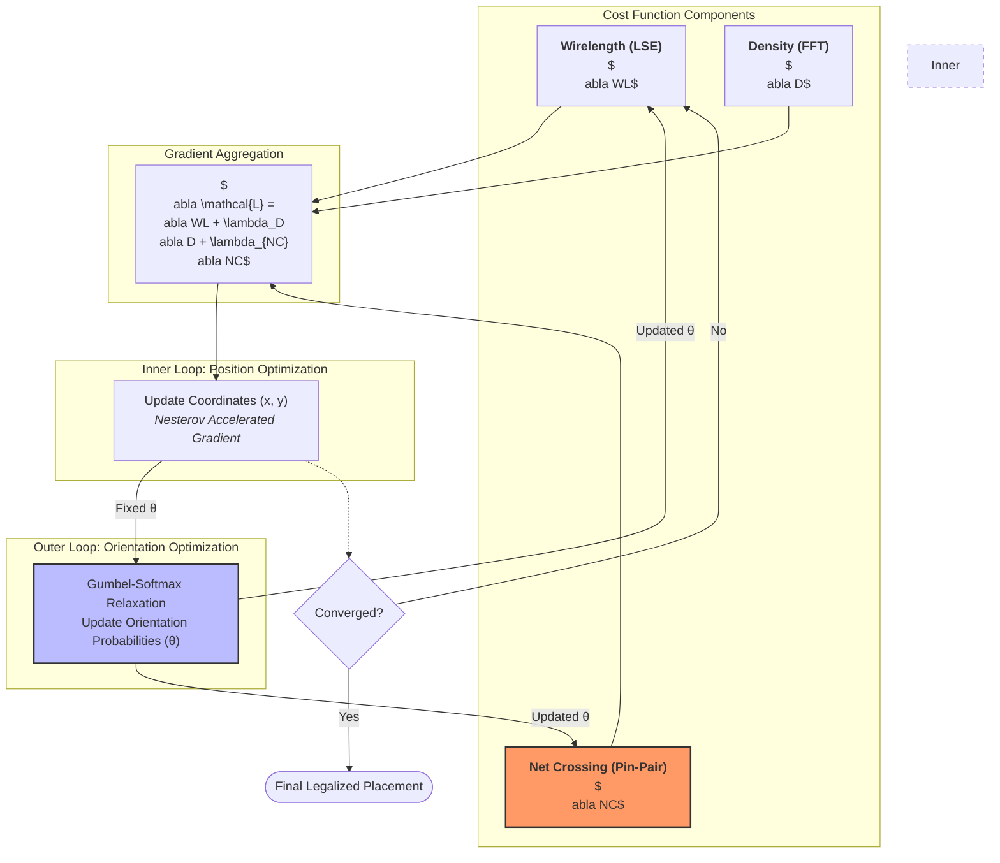

# Cypress Complete Workflow Documentation

This document provides a comprehensive guide to understanding and running the Cypress PCB placement framework. It details the overall workflow, primary entry points, dependencies (file formats, configurations), and generated artifacts. It is designed to be the primary reference for developers aiming to extend or adapt the Cypress codebase.

> [!NOTE]
> For VHL-specific integration details, bidirectional conversion logic, and hyperparameter tuning, please refer to the [Cypress & VHL Integration Handbook](./cypress_vhl_handbook.md).

## 1. Overall Workflow and Architecture

The Cypress framework operates in two distinct phases: **Data Preparation & Conversion** and **Non-Linear Global Placement**.
The transition between these phases is bridged by standard physical design exchange formats, primarily the **Bookshelf** format, enabling the VLSI-inspired placement engine to ingest PCB data.

### Phase 1: Data Preparation (`pcb-util/`)
PCB designs originate from commercial EDA tools (e.g., KiCad, Cadence Allegro via IDF). 
1. **Import:** `pcb-util/main.py` parses IDF or KiCad files and converts them into a custom, unified Intermediate Representation (IR) stored as `YAML`.
2. **Translation:** The IR is then translated into the VLSI standard **Bookshelf** format (`.nodes`, `.nets`, `.wts`, `.pl`, `.scl`) using `BookshelfConverter`.

### Phase 2: Placement Optimization (`dreamplace/`)
The Bookshelf design is fed into the GPU-accelerated placement engine.
1. **Initialization:** The engine loads a JSON configuration file containing hyperparameters.
2. **Global Placement:** Using PyTorch formulation, `NonLinearPlace.py` performs joint optimization on wirelength, component orientation, density, and net crossings.
3. **Legalization & Output:** Components are legalized, evaluated for congestion, and the final positions are saved as `.gp.pl`.

---

## 2. Primary Entry Points

### 2.1. `pcb-util/main.py`
This script handles all data loading, format conversion, and testing suite generation.
- **Key Functions:**
  - `generate_benchmark()`: Reads IDF, saves to `ir/*.yaml`, visualizes, and optionally outputs Bookshelf.
  - `import_from_kicad()`: Imports `.kicad_pcb` files via `KiCadConverter`, normalizes bounds, and dumps YAML and Bookshelf files.
  - `generate_mesh_dataset()`: Experimental function dumping 3D `.obj` meshes of placements.
- **Location:** `/pcb-util/main.py`
- **Execution:** Usually ran directly `python main.py` with modified internal function calls depending on the target dataset.

### 2.2. `dreamplace/Placer.py`
This is the heart of the Cypress engine, governing the optimization run.
- **Input:** Takes a JSON parameter file via command line argument (e.g., `python dreamplace/Placer.py path/to/config.json`).
- **Core Process (`PlacementEngine.run()`):** 
  - Parses JSON arguments and establishes `PlaceDB` (Python wrap around C++ Database).
  - Initializes `NonLinearPlace` to execute the multi-tiered $L_{gamma}$, $L_{lambda}$, and $L_{sub}$ loops.
  - Applies cell rotations (from Gumbel-Softmax logits).
  - Writes the `.gp.pl` placement file and computes the congestion map.
- **Location:** `/dreamplace/Placer.py`

---

## 3. Dependencies and Configurations

### 3.1. Infrastructure Dependencies
- **PyTorch (w/ CUDA):** Essential for autograd-based placement and GPU matrix parallelism.
- **C++/CUDA Operations:** Located in `dreamplace/ops/`. Custom forward/backward autograd functions (like `net_crossing`, `pin_pos`, `density_potential`) must be compiled via CMake beforehand. 

### 3.2. Configuration JSON (`params.json`)
The entire run is dependent on a JSON configuration file. A master list of definitions is housed in `dreamplace/params.json`.
**Critical Fields:**
- `"aux_input"`: Path to the `.aux` Bookshelf file (entry point parameter).
- `"target_density"`: Target spread for components.
- `"global_place_stages"`: Array defining iteration counts, learning rates, and grid bins (`num_bins_x`, `num_bins_y`).
- `"net_crossing_flag"`: Enables the custom $O(N^2)$ segment testing.
- `"enable_rotation"`: Enables gradient-based orientation logits.
- `"routability_opt_flag"`: Deflates routing congestion via node area adjustments.

---

## 4. Generated Artifacts

### 4.1. `pcb-util` Outputs
- **`ir/*.yaml`**: An intermediate abstract grouping of PCB components, nets, and design constraints. Allows manual edits before creating Bookshelf formats.
- **`visualize/*.png` / `*.pdf`**: Rendered topological maps of layouts and pins generated via matplotlib.
- **Bookshelf Folders**: Generated targets containing the required `.aux`, `.nodes`, `.nets`, `.wts`, `.pl`, and `.scl` needed for PyTorch execution.

### 4.2. `dreamplace` Outputs (Placement Engine)
Outputs are directed to the path specified in `"result_dir"` from the config JSON.
- **`<design_name>.gp.pl`**: The final global placement coordinates.
- **`plot/*.png`**: If `"plot_flag": 1`, sequential image snapshots of the layout are saved at designated intervals (e.g. `iteration 0`, `iteration 100`).
- **`placement.gif`**: If `"create_gif": 1`, stitches the plots into an animation for visual debugging.
- **`DREAMPlace.log`**: A granular operational log tracking epochs, HPWL (wirelength), overflow degradation, max density, and divergence heuristics.

## 5. Development Jumpstart Guide
To start prototyping or developing on Cypress:
1. Ensure the `dreamplace/ops` are compiled with CMake.
2. If working on data compatibility, inspect `pcb-util/converter.py` and `pcb-util/main.py`. Test your conversion to YAML explicitly.
3. If altering placement logic (e.g., adding thermal constraints), you will be editing `dreamplace/NonLinearPlace.py` (specifically `one_descent_step()` to add new constraints to gradients) and generating a new C++/CUDA operator inside `dreamplace/ops/` using Pytorch's C++ extension framework.
4. Run integration tests by executing `python dreamplace/Placer.py <test.json>`.

## 6. Gradient flow diagram

